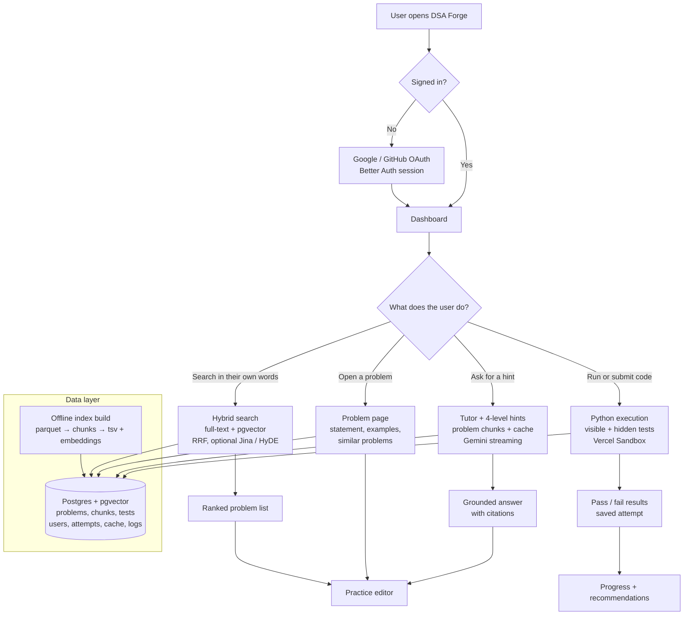

# DSA Forge

**Find the problem you half-remember. Learn the idea. Prove the solution.**

DSA Forge is a grounded interview-prep workspace for data structures and algorithms. Search understands a description in your own words, the tutor answers only from the problem's indexed material, and every Python submission runs against public and hidden tests in an isolated sandbox.

[Live app](https://dsa-forge-psi-gilt.vercel.app) · [Architecture](#architecture) · [Getting started](#getting-started)

## What it does

Most coding tools jump straight to an answer. DSA Forge is built around the loop that actually improves interview performance:

1. **Find.** Describe the problem the way you remember it. Hybrid search combines full-text and embedding retrieval, then optionally reranks the candidates.
2. **Understand.** Read the statement, constraints, public examples, and related problems. Ask a question or climb the four-level hint ladder.
3. **Solve.** Write Python in the Monaco editor. Run against every test case in a sandbox, then submit to save the attempt when it passes.
4. **Improve.** Attempts and hint usage update pattern-level stats. The dashboard recommends the weakest pattern you have not passed yet.

The app is deliberately narrow:

- **Grounded.** The tutor sees the problem's own chunks, not the whole corpus. It must cite the sources it used and say when the material is insufficient.
- **Gradual.** Hints move from naming the pattern to a full explained solution, one level at a time.
- **Verified.** Generated code is not shown as correct until it passes the same sandboxed tests as a human submission.
- **Measured.** Retrieval, answer faithfulness, and code generation have runnable evaluation scripts and committed reports.

## Architecture

The browser talks to Next.js App Router pages and authenticated API routes. Server components read problems and progress directly from Postgres; API routes handle search, tutor streaming, code execution, and attempt writes. Search fuses full-text and pgvector results before optional reranking; code always runs in an isolated Vercel Sandbox.



Search always requires a signed-in session, even though it does not write attempts. The tutor and code routes apply per-user rate limits and write best-effort `query_log` rows for latency and error reporting.

## The dataset

The index is built from `data/train.parquet`, a LeetCode-style dataset of problem statements, constraints, tags, test cases, and reference solutions.

The current seeded database contains:

| Item | Count |
|---|---:|
| Problems | 1,600 |
| Indexed chunks | 4,779 |
| Test cases | 50,504 |
| Public samples | 1,600 |
| Hidden cases | 48,904 |
| Embedding dimensions | 768 |

Each problem is split into section chunks:

- `statement` — the problem text
- `approach` — an explanation, when the upstream row has one
- `complexity` — complexity notes, when present
- `editorial` — constraints written as reference material
- `code` — the reference solution

The seeder indexes only text that actually exists. It does **not** synthesize generic `approach` or `complexity` prose, because placeholder chunks made the tutor look grounded when it was not. The seeder also exposes only the first test case as a worked sample; every remaining case is hidden from the browser.

`npm run data:check` is the guardrail for those promises. It verifies:

- no seeder placeholder chunks remain
- every problem has tests
- every problem exposes exactly one visible sample
- multi-test problems hide their extra cases
- every chunk has an embedding
- every chunk has a full-text vector

## Search

Search is a hybrid retrieval pipeline, not a single `LIKE` query.

1. **Full-text retrieval** searches the `tsv` index over problem chunks. Exact title matches are boosted; if no strict match exists, the query falls back to fuzzy term overlap after removing conversational filler.
2. **Vector retrieval** embeds the query with Gemini and runs cosine similarity over 768-dimensional pgvector embeddings.
3. **Fusion** merges the lists with weighted Reciprocal Rank Fusion. Body-keyword overlap is down-weighted because it is noisy on paraphrases; when vector results are available, keyword results join fusion only when they hit a problem title.
4. **Optional reranking** sends the top 20 merged problems to Jina's cross-encoder. The reranker can reorder candidates but cannot remove a strong retrieval hit.
5. **Optional HyDE** rewrites a vague query as a short hypothetical problem statement before embedding it.

The API returns up to 8 problems, with optional difficulty, pattern, and platform filters. Similar problems on a detail page combine shared pattern tags with statement-embedding distance.

### Fallbacks

- No Gemini key, embedding failure, or vector timeout → keyword-only results.
- No Jina key or reranker failure → hybrid/RRF results, with `rerankingAvailable: false`.
- HyDE failure → embed the raw query instead and report `hydeUsed: false`.

### Modes

The evaluation script can run each stage independently:

| Mode | Keyword | Vector | Rerank | HyDE |
|---|:---:|:---:|:---:|:---:|
| `keyword` | ✓ | | | |
| `vector` | | ✓ | | |
| `hybrid` | ✓ | ✓ | | |
| `reranked` | ✓ | ✓ | ✓ | |
| `hyde` | ✓ | ✓ | | ✓ |
| `hyde-reranked` | ✓ | ✓ | ✓ | ✓ |

The production API defaults to `reranked`.

### Tuning

All four fusion weights are environment overrides:

| Variable | Default | Effect |
|---|---:|---|
| `SEARCH_KEYWORD_WEIGHT` | `0.2` | Weight of the full-text list in RRF |
| `SEARCH_VECTOR_WEIGHT` | `1` | Weight of the embedding list in RRF |
| `SEARCH_RERANK_WEIGHT` | `1` | Weight of the reranker order when fused with retrieval rank |
| `SEARCH_TITLE_BOOST` | `5` | Extra multiplier when the query matches a problem title |

`JINA_RERANK_MODEL` selects the cross-encoder; the default is `jina-reranker-v3.5`. `GEMINI_EMBEDDING_MODEL` selects the embedding model; the default is `gemini-embedding-001`. `GEMINI_HYDE_MODEL` selects the rewrite model; the default is `gemini-3.8-flash`.

### Measured ablation

**Pre-cleanup baseline.** These rows were measured on 2026-11-14, before the 3,200 seeder placeholder chunks were removed from the index. The cleanup is applied and guarded by `npm run data:check`; re-run `npm run search:eval -- --fresh` before quoting the table as a post-cleanup result.

223 queries across 52 target problems, with **0 rerank failures and 0 HyDE failures**:

| Mode | Top-1 | Recall@5 | Recall@8 | MRR |
|---|---:|---:|---:|---:|
| Keyword only | 53.4% | 63.7% | 64.6% | 0.572 |
| Vector only | 87.4% | 96.4% | 97.3% | 0.912 |
| Hybrid / RRF | 90.6% | 97.3% | 98.2% | 0.932 |
| Hybrid + rerank | 89.7% | 98.7% | 98.7% | 0.937 |
| Hybrid + HyDE | 87.9% | 95.5% | 97.8% | 0.917 |
| Hybrid + rerank + HyDE | **92.4%** | **98.7%** | **99.1%** | **0.954** |

What the breakdown showed:

- Exact-title and pasted-statement queries are effectively solved once reranking is enabled; exact-title already reaches 98.1% Top-1 with hybrid alone.
- HyDE is not a win by itself. It costs recall and only becomes the best configuration after the cross-encoder repairs its candidate list.
- Vague “I'm stuck” queries remain the weak spot. At only 15 queries, a single result is worth 6.7 points, so treat that ordering as directional.
- HyDE rewrites are sampled at temperature 0.2, so those rows vary between runs. The reranked configurations reproduced exactly.

### Running the search evaluation

```bash
npm run search:eval
npm run search:eval -- --limit=20
npm run search:eval -- --modes=hybrid,reranked
npm run search:eval -- --delay-ms=5000
```

A full run checkpoints each completed mode to `reports/search-evaluation.checkpoint.json` and writes `reports/search-evaluation.json`. Partial and limited runs never overwrite the final report. Interrupted runs resume from the checkpoint; pass `--fresh` to ignore it. Each query is retried three times with backoff.

The reranker has a per-minute token limit. A request that falls back to RRF is counted in `rerankFailures`; a row with failures is not a reranked measurement.

## Tutor and hints

The tutor is a grounded explainer for one problem at a time, not a general chatbot.

### Context

It receives **every indexed chunk for that problem**, ordered statement → approach → complexity → reference solution → constraints. It does not run a global top-8 search to choose context: that can omit the reference solution and leave the model with only the statement.

The prompt requires it to:

- use only the supplied sources
- cite sources inline as `[Source 1]`, `[Source 2]`, and so on
- explain what the reference solution does when relevant
- say when the indexed material is insufficient
- never claim that code was tested or verified

### Hint ladder

Progressive hints use four levels:

1. Name the relevant pattern or topic.
2. Explain the central idea in one or two sentences.
3. Give a step-by-step approach or pseudocode.
4. Provide the complete solution and explain it.

The user controls when to move forward or back. Hint state is stored per user and problem.

### Streaming and caching

Tutor answers stream over Server-Sent Events with citations and a `cacheType` field. The cache has two layers:

- **Exact:** `problem + normalized question + hint level`.
- **Semantic:** on an exact miss, the question is embedded and the closest unexpired entry for the same problem and level is reused when cosine similarity is at least `ANSWER_CACHE_SIMILARITY` (default `0.95`).

Cached answers expire after 30 days and are returned through the same streaming contract with `X-Cache: HIT`. The cache key includes `TUTOR_PROMPT_VERSION`, and semantic lookup only considers rows from the current prompt version, so prompt changes do not serve stale answers. Hint levels 1–4 are exact-only.

`npm run cache:test` exercises the semantic path against a dedicated hint level and checks near-duplicate hits, different intent, unrelated text, level isolation, and expiry.

### Measured answer quality

12 sampled problems, answer model `gemini-3.8-flash`, generated 2026-11-14. Both runs completed with zero generation and judge failures:

| Judge | Faithfulness | Hallucinated | Unsupported claims | Citations | p50 / p95 |
|---|---:|---:|---:|---:|---:|
| `gemini-3.8-flash` (same model) | **5.00** | 0.0% (0/12) | 0.0% (0/128) | 100% | 13.1 s / 20.3 s |
| `gemini-2.5-flash` (independent) | **4.92** | 8.3% (1/12) | 1.1% (2/190) | 100% | 12.2 s / 18.9 s |

An earlier run scored 2.17/5 with a 91.7% hallucination rate. The cause was context selection, not the tutor model: a global top-8 search omitted the reference solution, and placeholder `approach` / `complexity` chunks were being treated as evidence. With the full problem context, answers describe the actual implementation and cite it.

The independent judge flags one answer for two claims about mapping cells to `(r % sideLength, c % sideLength)`. Manual review found both are implemented by the reference code, so this is judge strictness rather than an invented fact. Twelve problems is a small sample, and the same-model row can self-prefer; quote the independent row when independence matters.

### Running the answer evaluation

```bash
npm run answers:eval
npm run answers:eval -- --limit=20 --delay-ms=2000
GEMINI_JUDGE_MODEL=gemini-2.5-flash npm run answers:eval -- --suffix=-crossjudge
```

`--suffix` writes `answer-evaluation<suffix>.json` and `answer-review<suffix>.md`, so an independent-judge run does not overwrite the default report. Runs with generation or judge failures are written as `*.partial.json` / `*.partial.md` and never replace a clean report.

`GEMINI_TUTOR_MODEL` selects the answer, hint, and code-generation model. `GEMINI_JUDGE_MODEL` selects the judge. The judge is still a model; `reports/answer-review.md` is the manual sample check.

## Practice and code execution

The editor supports Python only. A solution must expose:

```python
class Solution:
    def solve(self, data):
        ...
```

`data` is the parsed JSON test input and the return value is compared with the expected JSON output.

### Run vs submit

- `POST /api/code/run` runs the submitted code against the problem's tests and returns the verdict without saving an attempt.
- `POST /api/attempts` runs the same tests, saves an `Attempt`, and rebuilds pattern statistics.

Example request:

```json
{
  "slug": "two-sum",
  "language": "python",
  "code": "class Solution:\n    def solve(self, data):\n        return data"
}
```

The API never accepts client-supplied tests. It loads the problem's test cases from PostgreSQL, runs each case in an isolated Vercel Sandbox with networking disabled, and returns only public inputs and outputs. Hidden inputs and expected outputs are never sent to the browser.

Limits: 100,000 characters per submission, three seconds per test case, and a 30-second sandbox timeout.

### Generated solutions

`POST /api/code/generate` uses the indexed problem context to produce a `Solution.solve(data)` implementation, verifies it in the same Sandbox, and sends visible failures back to Gemini for up to two repair retries. Hidden failures are reported only as hidden failures; their inputs and outputs never enter the repair prompt. A generated solution is not marked passed until it survives the same tests as a human submission.

### Code evaluation

```bash
npm run code:eval
```

The script samples problems, runs the same generation and verification path as production, and records first-attempt and final pass rates, retries, token counts, and execution time. It checkpoints to `reports/code-evaluation.checkpoint.json` so an interrupted run can resume. A final `reports/code-evaluation.json` has not been committed yet.

## Progress and recommendations

Every saved attempt records the problem, language, verdict, hints used, and execution time. Deleting an attempt also recomputes progress; another user's attempt is indistinguishable from a missing one and returns `404`.

Pattern stats are rebuilt from attempts. Each tracked pattern gets:

- attempt and pass counts
- average hints used
- a weakness score of **70% failure rate + 30% hint pressure**

The dashboard shows overall totals, recent attempts, the weakest patterns, and up to three unsolved problems from those patterns, ordered by difficulty.

```bash
npm run progress:rebuild
```

## Getting started

### Prerequisites

- Node.js 24 (the version used for the production build)
- npm
- Docker, for the local pgvector Postgres container
- Optional: Gemini, Jina, and Vercel Sandbox credentials for the full feature set

### Local setup

```bash
cp .env.example .env
npm install
npm run db:up
npm run db:prepare
npm run dev
```

Fill in at least `DATABASE_URL`, `BETTER_AUTH_SECRET`, and the Google/GitHub OAuth credentials in `.env`. Add `GEMINI_API_KEY` for vector search, tutor answers, and code generation. Add `JINA_API_KEY` for reranking.

`npm run db:prepare` runs, in order:

1. Prisma migrations
2. parquet import and chunking
3. full-text index build
4. 768-dimensional embedding generation

Embedding 4,779 chunks costs money and time. If you are connecting to an already seeded database, run only the migrations and data check instead:

```bash
npx prisma migrate deploy
npm run data:check
```

### Verify the index

```bash
npm run data:check
```

All six checks must pass before trusting search, tutor citations, or test coverage.

## Deployment

DSA Forge runs on Vercel with a hosted PostgreSQL database that supports the `vector` extension.

Set these variables in the Vercel project for Production and Preview:

| Variable | Purpose |
|---|---|
| `DATABASE_URL` | Hosted Postgres URL; append `?sslmode=require` |
| `BETTER_AUTH_SECRET` | Session signing secret (`openssl rand -base64 32`) |
| `BETTER_AUTH_URL` | Public origin, e.g. `https://dsa-forge-psi-gilt.vercel.app` |
| `GOOGLE_CLIENT_ID` / `GOOGLE_CLIENT_SECRET` | Google sign-in |
| `GITHUB_CLIENT_ID` / `GITHUB_CLIENT_SECRET` | GitHub sign-in |
| `GEMINI_API_KEY` | Embeddings, tutor, and code generation |
| `JINA_API_KEY` | Optional cross-encoder reranking |

Register the OAuth callbacks against the deployed origin:

```text
https://<host>/api/auth/callback/google
https://<host>/api/auth/callback/github
```

For Google, also add the deployed origin as an authorized JavaScript origin.

Apply migrations and verify the data:

```bash
npx prisma migrate deploy
npm run data:check
```

Production deployments on Vercel use the project's OIDC credentials automatically for Vercel Sandbox. For local code execution, link the project and pull development variables without committing the resulting file:

```bash
npx vercel link
npx vercel env pull .env.local
```

Without `GEMINI_API_KEY`, search still works in keyword-only mode. Vector search, tutor answers, and code generation need the key.

## Scripts

| Command | What it does |
|---|---|
| `npm run dev` | Start the development server |
| `npm run build` / `npm start` | Production build and server |
| `npm run lint` | Run ESLint |
| `npm run db:up` / `npm run db:down` | Start or stop the local pgvector container |
| `npm run db:prepare` | Migrate, seed, build full-text vectors, generate embeddings |
| `npm run db:seed` | Import `data/train.parquet` |
| `npm run db:search-index` | Rebuild full-text vectors |
| `npm run db:embeddings` | Fill missing chunk embeddings |
| `npm run data:check` | Verify the six data guardrails |
| `npm run search:eval` | Run the retrieval ablation |
| `npm run answers:eval` | Judge tutor answers for faithfulness |
| `npm run code:eval` | Measure generated-code pass rates |
| `npm run cache:test` | Exercise the semantic answer cache |
| `npm run logs:report` | Report latency, cache hits, errors, and tokens |
| `npm run progress:rebuild` | Recompute per-pattern stats |
| `npm run db:studio` | Open Prisma Studio |

## API

All routes except the auth handler require a signed-in Better Auth session.

| Route | Purpose | Rate limit |
|---|---|---:|
| `POST /api/search` | Hybrid problem search | — |
| `GET /api/problems/:slug` | Problem details, public tests, chunks, similar problems | — |
| `POST /api/tutor/ask` | Grounded answer streamed as SSE | 10/min |
| `POST /api/tutor/hint` | Next or previous hint level | 20/min |
| `POST /api/code/run` | Run Python against all tests without saving | 10/min |
| `POST /api/attempts` | Submit Python, save an attempt, rebuild stats | 20/min |
| `DELETE /api/attempts/:id` | Delete one of your own attempts | — |
| `POST /api/code/generate` | Generate and verify Python, up to two repairs | 5/min |
| `GET /api/me/progress` | Totals, weak patterns, recent attempts | — |
| `GET /api/me/recommendations` | Recommended unsolved problems | — |

## Logs and limits

Every search and tutor request writes a best-effort row to `query_log`:

- source (`search`, `tutor-ask`, `tutor-hint`)
- user and problem IDs
- cache-hit flag
- retrieval, LLM, total, and time-to-first-token latency
- token counts
- error message

A failed log never fails the request it measures.

```bash
npm run logs:report
npm run logs:report -- --days=30
npm run logs:report -- --source=tutor-ask
```

The report prints p50/p95 latency, cache-hit rate, error rate, and token totals per source. Set `GEMINI_INPUT_PRICE_PER_MTOK` and `GEMINI_OUTPUT_PRICE_PER_MTOK` to add an estimated cost column; without them, it reports tokens only.

## Project layout

```text
app/                 App Router pages and API routes
components/forge/    Landing, dashboard, problem, tutor, and editor UI
lib/                 Search, tutor, sandbox runner, auth, progress, cache
prisma/              Schema and migrations
scripts/             Seed, index, embed, evaluate, report
data/                train.parquet
reports/             Committed evaluation reports
```

## Notes

- Python is the only execution language in this version.
- One test case is public per problem; all other cases are hidden.
- Hidden test inputs and outputs are never returned to the client or the repair prompt.
- The search ablation is a pre-cleanup baseline; re-run it before quoting post-cleanup numbers.
- The tutor is grounded by design and will refuse to invent details when the indexed material is insufficient.
